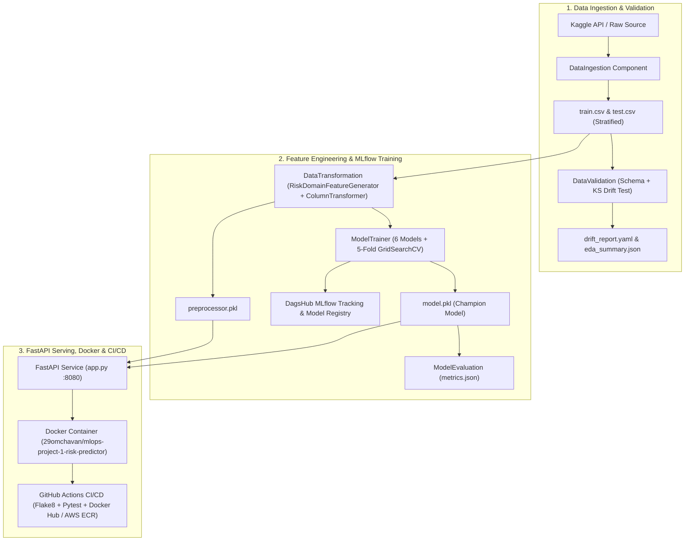

# Production MLOps Project 01: End-to-End Medical Insurance & Financial Risk Predictor

[](https://github.com/29OmChavan/mlops-project-1-risk-predictor/actions)
[](https://dagshub.com/29omchavan/mlops-project-1-risk-predictor)
[](https://hub.docker.com/r/29omchavan/mlops-project-1-risk-predictor)

An end-to-end, production-grade **Classical Machine Learning & MLOps system** covering the complete lifecycle from automated Kaggle data ingestion and statistical drift validation to custom `scikit-learn` feature engineering, multi-model hyperparameter tuning tracked live on **DagsHub MLflow**, **FastAPI** serving, **Docker** containerization, and **GitHub Actions CI/CD**.

---

## System Architecture



---

## Key Features & Production Engineering Highlights

1. **Modular 6-Layer Architecture**: Follows Krish Naik's production MLOps blueprint (`config.yaml` $\rightarrow$ `schema.yaml` & `params.yaml` $\rightarrow$ `entity` $\rightarrow$ `ConfigurationManager` $\rightarrow$ `components` $\rightarrow$ `pipeline`).
2. **Statistical Data Drift Detection**: Runs two-sample Kolmogorov-Smirnov (`ks_2samp`) tests between training and test distributions and enforces strict domain range/categorical rules from `schema.yaml`.
3. **Domain Feature Engineering Pipeline**: Custom `RiskDomainFeatureGenerator` (`is_obese`, `obese_smoker`, `bmi_age_interaction`) embedded inside a `scikit-learn` `Pipeline` & `ColumnTransformer` to eliminate training-serving skew.
4. **Multi-Model GridSearchCV + DagsHub MLflow**: Tunes `GradientBoostingRegressor`, `XGBRegressor`, `RandomForestRegressor`, `AdaBoostRegressor`, `DecisionTreeRegressor`, and `Ridge`, logging all runs and registering the champion model to [`dagshub.com/29omchavan/mlops-project-1-risk-predictor.mlflow`](https://dagshub.com/29omchavan/mlops-project-1-risk-predictor).
5. **Multi-Country Healthcare Ecosystems & Public vs. Private Insurance Tiers (`v2.0`)**: Dedicated actuarial datasets and trained ML models for **United States (`USD $`)**, **India (`INR ₹`)**, **United Kingdom (`GBP £`)**, and **Germany (`EUR €`)**, modeling country-specific Public, Hybrid, and Private insurance plans (e.g., Medicare/PPO, Ayushman Bharat/Floater, NHS/PMI, GKV/PKV).
6. **Height/Weight Anthropometrics, Lifestyle & 8 Chronic Comorbidities (`v2.0`)**: Computes exact BMI and WHO obesity classification from `height_cm` and `weight_kg`, alongside alcohol consumption, physical activity, past surgical/hospitalization history, and 8 chronic diseases (`Diabetes Type 2`, `Hypertension`, `Cardiovascular Disease`, `Asthma/COPD`, `Thyroid Disorder`, `Chronic Kidney Disease`, `Mental Health`, `Autoimmune/Arthritis`).
7. **Ephemeral Zero-Retention Medical Document Vault (`v2.0`)**: Enforces mandatory Terms & Conditions consent, extracts clinical biomarkers (`HbA1c`, `BP`, diagnoses) from uploaded medical reports, and cryptographically zero-wipes & deletes the file in milliseconds with an auditable SHA-256 deletion receipt.
8. **SHAP-Style Additive Explainability & AI Underwriting Agent (`v2.0`)**: Multi-page web portal (`/`, `/analytics`, `/explainability`, `/document-vault`) featuring local marginal coalition waterfall attributions, global permutation importance, counterfactual "What-If" savings, and an automated AI Underwriting & Clinical Explanation Agent.
9. **Automated Testing & CI/CD**: 8-test unit & integration test suite (`pytest`) and GitHub Actions workflow (`.github/workflows/main.yaml`).

---

## Documentation Index (Team Role Simulation)

* **[Complete Step-by-Step Implementation Guide](docs/IMPLEMENTATION_GUIDE.md)** — Detailed walkthrough of every module, design decision, and code snippet.
* **[Data Engineer: Data Requirement & Drift Spec](docs/01_DATA_SPEC.md)** — Schema constraints, deduplication, stratified split, and KS drift math.
* **[ML Researcher: Experiment Log & Model Card](docs/02_EXPERIMENT_LOG_AND_MODEL_CARD.md)** — Hypotheses, feature interaction math, 6-model benchmark table, and model card.
* **[ML & DevOps Engineer: Deployment Runbook & Playbook](docs/03_DEPLOYMENT_RUNBOOK.md)** — Local, Docker, and AWS ECR/EC2 deployment runbook + incident post-mortems.
* **[Changelog](CHANGELOG.md)** — Release history (`v1.0.0`).

---

## Quickstart

```bash
# 1. Install dependencies
python -m venv .venv
.\.venv\Scripts\Activate.ps1
pip install -r requirements.txt

# 2. Run the 5-stage training pipeline
python main.py

# 3. Run unit & integration tests
pytest tests/ -v

# 4. Start the FastAPI server (http://localhost:8080)
python app.py
```
