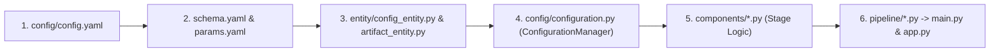

# Complete Step-by-Step Implementation Guide: Project 01 · End-to-End MLOps Risk Predictor

> **Purpose of this Document**: This guide walks through every single architectural decision, design pattern, mathematical formula, and critical code block used to build **Project 01** from an empty directory to a containerized, CI/CD-automated production ML system tracked on DagsHub MLflow.

---

## 1. System Architecture & MLOps Workflow Pattern

In production Machine Learning engineering (as taught in Krish Naik's *End-to-End MLOps Data Science Project Implementation* and DataTalks.Club's *MLOps Zoomcamp*), we never write monolithic Jupyter notebooks for deployment. Instead, every stage of the ML lifecycle follows a **strict 6-step modular workflow**:



### Why This Decoupled Architecture Matters
1. **Zero Hardcoded Paths**: All paths, URLs, and thresholds live in `config/config.yaml`.
2. **Type-Safe Contracts**: Every component accepts an immutable `@dataclass(frozen=True)` Config object (`entity/config_entity.py`) and returns an immutable `@dataclass(frozen=True)` Artifact object (`entity/artifact_entity.py`).
3. **Reproducible Experimentation**: Model hyperparameters live exclusively in `params.yaml` and data validation rules live in `schema.yaml`.

---

## 2. Step-by-Step Implementation Walkthrough

### Step 1: Project Scaffolding (`template.py` & `setup.py`)
Instead of creating folders manually, `template.py` programmatically creates the `src/risk_predictor/` package hierarchy (`components`, `config`, `constants`, `entity`, `pipeline`, `utils`), configuration files, `tests/`, and `docs/`.
- **`setup.py` & `-e .` in `requirements.txt`**: Installing the project in **editable mode** (`pip install -e .`) registers `src/risk_predictor` in the Python environment's `site-packages`. This allows any file (`app.py`, `main.py`, `tests/test_pipeline.py`) to import `from src.risk_predictor...` cleanly without `sys.path` hacks, and ensures `joblib` can serialize/deserialize custom scikit-learn transformers (`RiskDomainFeatureGenerator`) reliably across processes.

---

### Step 2: Production Logging & Exception Handling (`logger.py` & `exception.py`)
In production containers, `print()` statements are lost or lack context.
- **`src/risk_predictor/logger.py`** configures Python's `logging` module with two simultaneous handlers:
  1. `FileHandler`: Writes timestamped log files to `logs/YYYY_MM_DD_HH_MM_SS.log`.
  2. `StreamHandler(sys.stdout)`: Streams logs to standard output so `docker logs` and AWS CloudWatch capture every event.
- **`src/risk_predictor/exception.py`** inspects the Python interpreter's execution frame (`sys.exc_info()`) to report the **exact filename and line number** where an exception originated:

```python
def error_message_detail(error: Exception, error_detail: sys) -> str:
    _, _, exc_tb = error_detail.exc_info()
    file_name = exc_tb.tb_frame.f_code.co_filename if exc_tb else "unknown"
    line_number = exc_tb.tb_lineno if exc_tb else 0
    return (
        f"Error occurred in python script name [{file_name}] "
        f"line number [{line_number}] error message [{str(error)}]"
    )
```

---

### Step 3: Stage 01 — Data Ingestion (`components/data_ingestion.py`)
**What it does**:
1. Downloads the Medical Insurance Risk dataset (`mirichoi0218/insurance`, 1,338 records) via the **Kaggle API v1** using `~/.kaggle/access_token` (or `KAGGLE_API_TOKEN`), with automatic fallback to a raw dataset mirror URL and an offline deterministic generator for air-gapped CI environments.
2. Deduplicates exact duplicate rows (`1,338 -> 1,337` unique records).
3. Performs an **80/20 stratified train-test split** on the `smoker` column so that both `train.csv` (1,069 rows) and `test.csv` (268 rows) preserve the exact 20.5% smoker ratio.

---

### Step 4: Stage 02 — Data Validation & Statistical Drift Detection (`components/data_validation.py`)
Before training any model, `DataValidation` enforces three gates against `schema.yaml`:
1. **Schema Gate**: Verifies all 7 expected columns (`age`, `sex`, `bmi`, `children`, `smoker`, `region`, `charges`) exist and checks null counts.
2. **Domain Range & Category Gate**: Verifies $18 \le \text{age} \le 100$, $10.0 \le \text{bmi} \le 70.0$, $0 \le \text{children} \le 10$, and valid categorical values (`sex`, `smoker`, `region`).
3. **Covariate Drift Gate (`detect_dataset_drift`)**: Runs the two-sample **Kolmogorov-Smirnov test (`scipy.stats.ks_2samp`)** comparing `train.csv` vs. `test.csv` for every numerical feature:

```python
stat_res = ks_2samp(train_df[col].dropna(), test_df[col].dropna())
is_drifted = bool(stat_res.pvalue < alpha)  # alpha = 0.05
```

Outputs are persisted to `artifacts/data_validation/status.txt`, `drift_report.yaml`, and `eda_summary.json`.

---

### Step 5: Stage 03 — Feature Engineering & Data Transformation (`components/data_transformation.py`)
**Critical Insight**: Medical insurance charges have a strong non-linear interaction between obesity ($\text{BMI} \ge 30$) and smoking (`smoker == 'yes'`).
We encapsulate this domain logic inside a custom scikit-learn `BaseEstimator, TransformerMixin` class so it is automatically saved inside `preprocessor.pkl` and applied identically during training and real-time FastAPI inference (preventing **training-serving skew**):

```python
class RiskDomainFeatureGenerator(BaseEstimator, TransformerMixin):
    def fit(self, X: pd.DataFrame, y=None):
        return self

    def transform(self, X: pd.DataFrame) -> pd.DataFrame:
        X_out = X.copy()
        is_obese = (X_out["bmi"].astype(float) >= 30.0).astype(float)
        is_smoker = (X_out["smoker"].astype(str).str.lower() == "yes").astype(float)
        X_out["is_obese"] = is_obese
        X_out["obese_smoker"] = is_obese * is_smoker
        X_out["bmi_age_interaction"] = (
            X_out["bmi"].astype(float) * X_out["age"].astype(float)
        ) / 100.0
        return X_out
```

The `RiskDomainFeatureGenerator` feeds directly into a `ColumnTransformer`:
- **Numerical Pipeline**: `SimpleImputer(strategy="median")` $\rightarrow$ `StandardScaler()`
- **Categorical Pipeline**: `SimpleImputer(strategy="most_frequent")` $\rightarrow$ `OneHotEncoder(handle_unknown="ignore")` $\rightarrow$ `StandardScaler(with_mean=False)`

The fitted pipeline is saved to `artifacts/data_transformation/preprocessor.pkl`.

---

### Step 6: Stage 04 — Model Trainer & MLflow Experiment Tracking (`components/model_trainer.py`)
**What it does**:
1. Iterates over 6 regression algorithms (`RandomForestRegressor`, `GradientBoostingRegressor`, `XGBRegressor`, `AdaBoostRegressor`, `Ridge`, `DecisionTreeRegressor`).
2. Runs 5-fold cross-validated `GridSearchCV` over the hyperparameter grids in `params.yaml`.
3. Connects to **DagsHub Remote MLflow** (`https://dagshub.com/29omchavan/mlops-project-1-risk-predictor.mlflow`) and logs **every candidate model's best hyperparameters and metrics (`cv_r2`, `train_r2`, `test_r2`, `test_rmse`, `test_mae`)**.
4. Enforces a minimum quality gate (`expected_r2_threshold: 0.75`), saves the full leaderboard to `artifacts/model_trainer/model_comparison.json`, and serializes the winning model to `artifacts/model_trainer/model.pkl`.

---

### Step 7: Stage 05 — Model Evaluation & MLflow Model Registry (`components/model_evaluation.py`)
Computes final held-out test metrics:
- **Coefficient of Determination ($R^2$)** and **Adjusted $R^2$**:
  $$R^2_{\text{adj}} = 1 - \frac{(1 - R^2)(n - 1)}{n - p - 1}$$
- **Root Mean Squared Error ($\text{RMSE}$)**, **Mean Absolute Error ($\text{MAE}$)**, and **Mean Absolute Percentage Error ($\text{MAPE}$)**.
- Saves `artifacts/model_evaluation/metrics.json` and registers the champion model in the **MLflow Model Registry** under `InsuranceRiskPredictorModel`.

---

### Step 8: Stage 06 — FastAPI Prediction Service (`app.py` & `prediction_pipeline.py`)
`app.py` exposes 5 production endpoints:
- `GET /`: Interactive dark-mode HTML dashboard (`templates/index.html`) showing live MLflow champion metrics and a prediction form.
- `POST /predict`: JSON REST API validated by `RiskPredictionRequest` (Pydantic `Field` constraints reject out-of-range inputs with HTTP `422` before model execution).
- `POST /predict-form`: Handles web form submissions.
- `GET /health`: Container health probe checking artifact availability.
- `GET /metrics`: Returns JSON evaluation metrics and the 6-model comparison leaderboard.
- `POST /train`: Triggers `TrainingPipeline().run_pipeline()` on demand.

---

### Step 9: Stage 07 & 08 — Dockerization & CI/CD Pipeline (`Dockerfile`, `.github/workflows/main.yaml`)
- **`Dockerfile`**: Uses `python:3.10-slim`, installs `libgomp1` (required by XGBoost's OpenMP runtime), caches `pip install -r requirements.txt` in a dedicated layer, copies artifacts, exposes port `8080`, and defines a native Docker `HEALTHCHECK` against `/health`.
- **`.github/workflows/main.yaml`**:
  1. **Continuous Integration**: Runs on every push/PR — installs dependencies, runs `flake8` syntax/undefined-name checks, executes `python main.py`, and runs `pytest tests/ -v`.
  2. **Continuous Delivery**: Builds and pushes `29omchavan/mlops-project-1-risk-predictor:latest` to Docker Hub (and AWS ECR when AWS secrets are active).
  3. **Continuous Deployment**: Deploys the updated container to an AWS EC2 self-hosted runner.
